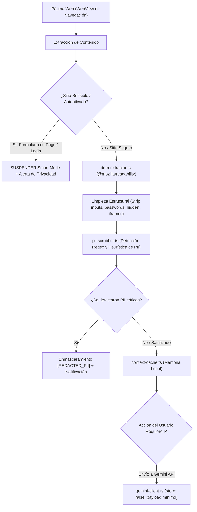

# AGENTS.md — Manual de Arquitectura, Especificaciones, Testing y Seguridad para Dalaran Browser (Dalaran Browser)

> **Propósito del Documento:**  
> Este archivo constituye la **fuente de verdad técnica, operativa y arquitectónica** para cualquier agente de IA o desarrollador que trabaje en el repositorio `dalaran_browser`. Define rigurosamente la arquitectura del sistema, los contratos de interfaz, las directrices de implementación, la suite completa de pruebas de flujos críticos, y los protocolos obligatorios de seguridad, privacidad y auditoría de datos personales (PII).

> [!IMPORTANT]
> **Regla General de Control de Versiones (Git / PRs):**
> Los agentes de IA **tienen estrictamente prohibido ejecutar commits, pushes o crear/fusionar Pull Requests** (`git commit`, `git push`, `gh pr create`, etc.). El agente puede ayudar a preparar y redactar mensajes de commit o descripciones de PR, y ejecutar comandos de solo lectura (`git status`, `git diff`), pero **toda ejecución de commits y PRs queda exclusivamente a cargo del usuario**.

---

## 1. Visión General del Producto y Principios Rectores

**Dalaran Browser** es un navegador web de lectura profunda, síntesis y captura activa de conocimiento. Su objetivo central es resolver la fricción cognitiva de abandonar el hilo de lectura al buscar definiciones, traducir términos, tomar apuntes estructurados o debatir ideas complejas con inteligencia artificial, manteniendo en todo momento el contexto semántico del documento en memoria viva.

### Principios Fundamentales
1. **Rendimiento Nativo y Cero Bloqueo:** Huella de memoria mínima apoyándose en los WebViews nativos del sistema operativo a través de **Tauri v2**, con una interfaz ultra-ligera en **Preact + TypeScript**.
2. **Desacoplamiento Absoluto para Portabilidad:** La lógica de negocio y la interfaz no dependen directamente de Tauri ni de Electron. Toda comunicación con el sistema host ocurre a través de una interfaz de puente agnóstica (`bridge.ts`).
3. **Privacidad Radical y Protección de Datos Personales (PII):** El usuario navega en sitios que pueden contener información confidencial (webmail, banca, intranets, datos médicos, credenciales). Ningún dato sensible, campo de formulario, contraseña o token personal debe ser extraído ni transmitido a modelos de lenguaje externos.
4. **Eficiencia en Tokens y Caching en Memoria:** Reducción agresiva de ruido del DOM (vía `@mozilla/readability`) antes de cualquier llamada a LLM, cacheando la temática global por pestaña para evitar llamadas redundantes a las APIs en la nube.
5. **Markdown Vivo y Bidireccional:** El contenido leído y las anotaciones del usuario forman un grafo en memoria con anclaje bidireccional entre citas y notas, exportable en tres modalidades limpias y reproducibles.

---

## 2. Stack Tecnológico e Invariantes Técnicas

| Capa | Tecnología Seleccionada | Justificación y Reglas |
| :--- | :--- | :--- |
| **Shell Host** | **Tauri v2 + Rust** | Rendimiento nativo, binario ligero, WebViews nativos del SO (WebKitGTK en Linux, WebKit en macOS/iOS, WebView2 en Windows). |
| **Abstracción IPC** | `src/platform/bridge.ts` | **Invariante:** Prohibido invocar `@tauri-apps/api` directamente fuera de `src/platform/tauri-adapter.ts`. Debe existir soporte listo para `src/platform/electron-adapter.ts`. |
| **Frontend UI** | **Preact + TypeScript** | Alternativa a React con bundle diminuto (<4KB) y alto rendimiento. Empaquetado con `@preact/preset-vite`. |
| **Gestión de Estado** | **Preact Signals** (`@preact/signals`) | Reactividad atómica de alto rendimiento. Evita re-renderizados innecesarios del árbol de componentes. |
| **Limpieza de DOM y PDFs** | `@mozilla/readability` + `pdfjs-dist` | Extracción semántica HTML (descarte de navbars, footers, publicidad) y soporte unificado para documentos PDF. |
| **Inferencia IA** | **Google Gemini API** (`@google/genai`) | Modelos optimizados: `gemini-3.5-flash-lite` / `gemini-4-hydrogen` para pre-escaneo rápido, definiciones y traducción; `gemini-4-carbon` / `gemini-4-argon` para debate contextual profundo. |
| **Autenticación** | **Google OAuth 2.0 (PKCE) + BYOK** | Onboarding opcional con Google OAuth 2.0 o API Key propia (BYOK) de Gemini Studio. Almacenamiento seguro en el llavero nativo del SO en Rust. |
| **Persistencia Local** | SQLite / Store Cifrado (con Modo Incógnito) | Auto-guardado anti-pérdida de sesiones y notas activas, desactivable completamente en Modo Incógnito / Efímero. |
| **Testing** | **Vitest + Playwright / Webdriver** | Pruebas unitarias, mocks de bridge IPC, tests de componentes y pruebas de integración extremo a extremo. |

---

## 3. Estructura de Directorios y Contratos de Módulos

Todo desarrollo en el repositorio debe respetar estrictamente la siguiente jerarquía de archivos:

```text
smart-browser/
├── package.json                  # Dependencias de Preact, Readability, Gemini SDK y scripts
├── tsconfig.json                 # Configuración estricta de TypeScript
├── vite.config.ts                # Bundler ligero con @preact/preset-vite
├── index.html                    # Entry point de la Shell UI
├── src/                          # Frontend desacoplado (Preact + TypeScript)
│   ├── main.tsx                  # Montaje inicial del DOM de la aplicación
│   ├── app.tsx                   # Layout principal (Toolbar, Contenedor WebView, AdaptivePanel)
│   ├── platform/                 # Capa de Abstracción de Plataforma (Hexagonal)
│   │   ├── bridge.ts             # Interface unificada IPlatformBridge
│   │   ├── tauri-adapter.ts      # Implementación nativa usando @tauri-apps/api/core
│   │   ├── electron-adapter.ts   # Stub y adaptador para portabilidad futura a Electron
│   │   └── mock-adapter.ts       # Adaptador simulado para tests unitarios y desarrollo web
│   ├── core/                     # Lógica de negocio pura (independiente de UI y plataforma)
│   │   ├── dom-extractor.ts      # Limpieza y extracción semántica de contenido seguro
│   │   ├── pii-scrubber.ts       # Detección y enmascaramiento de datos personales sensibles
│   │   ├── context-cache.ts      # Gestión de caché LRU en memoria (temática y entidades)
│   │   ├── markdown-engine.ts    # Modelo de notas, hipervínculos bidireccionales y exportador
│   │   └── selection-tracker.ts  # Mapeo de rangos, coordenadas y anclas en el texto limpio
│   ├── services/                 # Clientes de servicios externos y autenticación
│   │   ├── google-auth.ts        # Flujo OAuth 2.0 PKCE y refresco de tokens
│   │   └── gemini-client.ts      # Integración con @google/genai (escaneo, definición, traducción, chat)
│   ├── injected/                 # Scripts aislados para inyección en el WebView de navegación
│   │   └── content-script.ts     # Captura segura de selección, rangos DOM y emisión IPC
│   ├── components/               # Componentes de presentación UI en Preact
│   │   ├── BrowserBar.tsx        # Barra de URL, controles de navegación y toggle Smart Mode
│   │   ├── OnboardingModal.tsx   # Modal de invitación a iniciar sesión con Google
│   │   ├── AuthToast.tsx         # Aviso contextual al intentar usar Smart Mode sin sesión
│   │   ├── SelectionPopover.tsx  # Menú contextual flotante (Definir, Traducir, Nota, Chat)
│   │   ├── AdaptivePanel.tsx     # Contenedor adaptativo (Side Panel desktop / Bottom Drawer móvil)
│   │   ├── DefinitionView.tsx    # Tarjeta de definición contextual y traducción en panel
│   │   ├── NoteEditorView.tsx    # Editor de anotaciones vinculadas y selector de exportación
│   │   └── ContextualChat.tsx    # Chat reactivo en streaming con inyección contextual
│   └── store/                    # Estado global reactivo con Preact Signals
│       └── session-store.ts      # Pestañas, toggle Smart Mode, notas en memoria y selección activa
└── src-tauri/                    # Backend nativo en Rust (Tauri v2)
    ├── Cargo.toml                # Dependencias Rust (tauri, reqwest, serde, keyring, tauri-plugin-dialog)
    ├── tauri.conf.json           # Configuración de ventanas, CSP y permisos multi-webview
    └── src/
        ├── main.rs               # Entrada binaria del runtime nativo
        ├── lib.rs                # Registro de comandos y plugins
        ├── state.rs              # Estado concurrente de Rust (sesiones activas y tokens)
        ├── error.rs              # Enumeración exhaustiva de errores (AppError)
        └── commands/
            ├── auth.rs           # Callback HTTP local para OAuth 2.0 y almacenamiento seguro
            ├── webview.rs        # Orquestación de WebViews secundarios e inyección de scripts
            └── export.rs         # Guardado seguro de archivos .md (protección contra Path Traversal)
```

---

## 4. Contrato de Portabilidad: `IPlatformBridge`

Cualquier acceso a recursos nativos del sistema (sistema de archivos, almacenamiento de credenciales, control de ventanas o webviews) debe pasar por `bridge.ts`. 

```typescript
// src/platform/bridge.ts
export interface NavigationOptions {
  url: string;
  smartModeEnabled: boolean;
}

export interface TextSelectionPayload {
  selectedText: string;
  contextSurrounding: string;
  rect: { x: number; y: number; width: number; height: number };
  anchorOffset: number;
}

export interface ExportMarkdownOptions {
  filename: string;
  content: string;
  suggestedDirectory?: string;
}

export interface IPlatformBridge {
  // Autenticación (OAuth 2.0 + BYOK)
  initiateOAuthLogin(): Promise<{ authUrl: string }>;
  handleOAuthCallback(code: string): Promise<{ accessToken: string; userEmail: string }>;
  saveApiKey(apiKey: string): Promise<void>;
  getStoredCredentials(): Promise<{ accessToken: string | null; apiKey: string | null; userEmail: string | null }>;
  clearCredentials(): Promise<void>;

  // Gestión de WebViews y navegación
  createBrowsingView(containerId: string, initialUrl: string): Promise<void>;
  navigateBrowsingView(url: string): Promise<void>;
  executeInContentScript<T>(scriptCode: string): Promise<T>;
  onSelectionEvent(callback: (payload: TextSelectionPayload) => void): () => void;

  // Sistema de archivos nativo
  saveMarkdownFileDialog(options: ExportMarkdownOptions): Promise<{ success: boolean; filePath?: string }>;

  // Métricas y plataforma
  getPlatformInfo(): { isMobile: boolean; os: 'linux' | 'macos' | 'windows' | 'android' | 'ios' };
}
```

---

## 5. Especificación de Flujos de Trabajo Clave

### Flujo 1: Onboarding y Autenticación con Google OAuth 2.0 y BYOK
1. **Primera Ejecución:** La aplicación arranca y comprueba credenciales seguras vía `bridge.getStoredCredentials()` (ya sea sesión OAuth 2.0 o API Key BYOK).
2. **Comportamiento Anónimo (Degraded Mode):** Si no hay credenciales, la app permite navegar normalmente como un navegador estándar web.
3. **Activación de Smart Mode sin sesión:**
   - Si el usuario conmuta el switch de *Smart Mode* en `BrowserBar.tsx` sin estar autenticado ni tener API Key, la acción se bloquea inmediatamente y se despliega `AuthToast.tsx`.
   - El toast ofrece tres opciones: "Iniciar sesión con Google", "Ingresar API Key (BYOK)" o "Seguir navegando en modo clásico".
4. **Login con PKCE / Almacenamiento BYOK:**
   - En modo OAuth, el backend nativo en Rust abre un socket loopback efímero local (`http://127.0.0.1:<PORT>/oauth/callback`) con timeout de 120 segundos, usando `code_challenge` (S256).
   - En modo BYOK, el usuario ingresa su API Key de Google AI Studio.
   - Tanto los tokens OAuth como la API Key BYOK se guardan de inmediato en el **almacén seguro de credenciales nativo del SO** (Keychain/Secret Service/DPAPI). **Nunca** en `localStorage`.

### Flujo 2: Orquestación Multi-Webview y Aislamiento de Procesos
1. **Aislamiento Estricto:** La interfaz del navegador (barra superior, paneles laterales, popovers) corre en la ventana principal de la Shell UI (`tauri://localhost` o `index.html`).
2. **Webview de Navegación Aislado:** El contenido de internet de terceros se renderiza en un `Webview` hijo o secundario desacoplado del contexto de la shell.
3. **Seguridad IPC:** La página web externa no tiene acceso al objeto `window.__TAURI__` ni a APIs nativas.
4. **Inyección de `content-script.ts`:**
   - Al completar la carga de cada página (`DOMContentLoaded` o evento de navegación en Rust), el host inyecta `content-script.ts`.
   - El script inyectado monitoriza eventos de selección de texto y coordenadas del puntero.

### Flujo 3: Activación de Smart Mode, Extracción y Sanitización (HTML y PDFs)
1. Al navegar a una nueva URL o abrir un documento PDF con *Smart Mode* activo:
   - Si es HTML, el host solicita el DOM del documento al WebView secundario y lo procesa con `dom-extractor.ts` (`@mozilla/readability`).
   - Si es PDF (local o remoto), el visor integrado basado en `pdfjs-dist` extrae el texto estructurado hacia el mismo contrato de `dom-extractor.ts`.
   - **Regla de oro de sanitización:** Se eliminan etiquetas de script, estilos, iframes, formularios completos (`<form>`), entradas de texto (`<input>`, `<textarea>`, `<select>`), campos de contraseña, elementos ocultos (`type="hidden"`), y elementos con atributos `data-sensitive` o clases de autenticación.
   - El texto extraído se pasa por el módulo `pii-scrubber.ts` para enmascarar datos personales antes de entrar a la memoria de la sesión.

### Flujo 4: Pre-escaneo y Cacheo de Temática en Memoria
1. El texto limpio y sanitizado es procesado en segundo plano:
   - Si el contenido excede el umbral óptimo de tokens (~10.000 palabras), se realiza un chunking semántico de las primeras secciones y subtítulos clave.
   - Se invoca a Gemini con el modelo rápido `gemini-3.5-flash-lite` (o `gemini-4-hydrogen`) solicitando un esquema JSON estructurado:
     ```json
     {
       "topic": "Resumen conciso en 1-2 oraciones del propósito del sitio",
       "keyEntities": ["entidad1", "concepto2", "autor3"],
       "domainCategory": "tecnologia | finanzas | medicina | literatura | general"
     }
     ```
   - Este resultado se almacena en `context-cache.ts` indexado por la URL canónica de la pestaña.
   - Si la pestaña se cierra o se navega a otro dominio, la entrada se invalida o se somete a recolección de basura.

### Flujo 5: Detección de Selección, Popover en Shadow DOM y Atajos de Teclado
1. El usuario selecciona un fragmento de texto en la página.
2. `content-script.ts` intercepta el evento `selectionchange` / `mouseup` y calcula el bounding rect en coordenadas relativas al viewport.
3. **Renderizado en Shadow DOM Cerrado:** Para evitar problemas de superposición (*z-index*) sobre WebViews nativos en Linux (WebKitGTK/Wayland) o Windows (WebView2), `SelectionPopover` se monta dentro de un Shadow DOM cerrado (`attachShadow({ mode: 'closed' })`) inyectado por `content-script.ts`, completamente aislado del CSS y scripts de la página anfitriona.
4. El popover y los atajos globales (*Keyboard-First*) exponen las 4 acciones prioritarias:
   - **Definición Contextual (`Alt+D`):** Explica el término a la luz de la temática global cacheada.
   - **Traducción (`Alt+T`):** Traduce el fragmento al idioma preferido del usuario.
   - **Nota (`Alt+N`):** Abre campo de texto para registrar una nota asociada al offset del texto.
   - **Debate / Chat (`Alt+C`):** Inicia el chat contextual anclado a esa selección específica.
   - Atajos de navegación adicionales: `Ctrl+L` (foco en barra de URL) y `Alt+S` (activar/pausar Smart Mode).

### Flujo 6: Paneles Adaptativos (Desktop vs Mobile)
- **Modo Desktop:** `AdaptivePanel.tsx` se despliega como un panel lateral derecho (*Side Panel*) de ancho ajustable, permitiendo leer el contenido en paralelo con el chat o las notas.
- **Modo Móvil / Pantallas Angostas:** Se transforma en un panel inferior (*Bottom Drawer*) que se eleva hasta el 50% de la altura de la pantalla, garantizando que el fragmento de texto seleccionado permanezca visible en la mitad superior.

### Flujo 7: Sistema de Notas, Resaltado Visual y Markdown Vivo (`markdown-engine.ts`)
1. **Representación de Datos en Memoria y Respaldo Anti-Pérdida:**
   ```typescript
   export interface NoteItem {
     id: string;              // UUID único
     selectedText: string;    // Fragmento citado exacto (TextQuoteSelector)
     userNote: string;        // Texto de la nota ingresado por el usuario
     anchorId: string;        // Identificador slug para anclaje (ej. 'nota-entropia-1')
     timestamp: number;
   }

   export interface SessionMarkdownState {
     sourceUrl: string;
     pageTitle: string;
     cleanedBodyText: string;
     notes: NoteItem[];
     isIncognito: boolean;    // Si true, no se persiste nada en disco
   }
   ```
   - **Resaltado Visual en Vivo (`CSS.highlights`):** `content-script.ts` pinta los fragmentos anotados mediante la **CSS Custom Highlight API** (sin mutar el DOM original ni interferir con frameworks como React/Vue).
   - **Persistencia Local Anti-Pérdida:** Salvo que el usuario active el **Modo Incógnito / Efímero**, las sesiones y notas activas se auto-guardan localmente (SQLite o almacén cifrado) para permitir su recuperación inmediata tras cierres accidentales.
2. **Generación Bidireccional en Tiempo Real:**
   - En el cuerpo del texto exportado, cada término resaltado que posee una nota se convierte en: `[Término resaltado](#nota-{id}){: .smart-annotation}`.
   - En la sección inferior de notas, cada entrada cuenta con: `### Nota {id}: Término\n\n{userNote}\n\n[↩ Volver al texto](#ref-{id})`.
3. **Tres Modalidades de Exportación (`.md`):**
   - **Modo 1 (Texto limpio):** Únicamente el contenido extraído y limpio del sitio web.
   - **Modo 2 (Texto con anotaciones):** El documento limpio completo con hipervínculos bidireccionales y el pie de notas.
   - **Modo 3 (Solo anotaciones):** Resumen ejecutivo con formato:
     ```markdown
     # Notas de lectura: [Título de la página](URL)
     > "Fragmento citado"
     
     **Nota:** Comentario del usuario.
     ```

### Flujo 8: Chat Contextual Reactivo (`ContextualChat.tsx`)
1. **Comportamiento Orgánico:** Al abrirse el chat, **no** debe forzar sugerencias de preguntas ni preguntas precocinadas; permanece en espera pasiva de la inquietud del usuario.
2. **Ensamblado Dinámico del Prompt:**
   - System instructions: Rol de asistente de lectura profunda, conciso, analítico y basado en evidencia del documento.
   - Contexto inyectado: Temática cacheada (`topic`), entidades clave, notas registradas por el usuario en la sesión, y la selección de texto específica (o el texto limpio completo si la consulta es global).
3. **Streaming y Manejo Efímero:**
   - La respuesta del modelo se recibe vía streaming mediante `@google/genai` con `ai.models.generateContentStream` o `chats.create`.
   - Se establece `store: false` para evitar retención innecesaria o entrenamiento con datos de navegación del usuario.

---

## 6. Auditoría Exhaustiva de Seguridad y Privacidad de Datos Personales (PII)

> [!CAUTION]
> **Riesgo Crítico de Fuga de Información Personal:**
> Al ser un navegador que procesa texto con modelos de lenguaje en la nube, el mayor vector de vulnerabilidad es la transmisión accidental de contraseñas, estados de cuenta bancarios, correos privados, datos médicos o tokens de sesión hacia la API externa de IA.

Todo agente que implemente o modifique código en este repositorio debe aplicar y auditar las siguientes barreras defensivas:



### 6.1. Detección y Enmascaramiento de PII (`pii-scrubber.ts`)
Antes de almacenar cualquier texto en caché o enviarlo a un LLM, debe pasar por el pipeline de scrubbing:
1. **Tarjetas de Crédito y Débito:** Detección de patrones numéricos de 13 a 19 dígitos verificados mediante el **algoritmo de Luhn**. Reemplazo por `[REDACTED_CARD_NUMBER]`.
2. **Documentos de Identidad (DNI, SSN, Pasaportes):** Filtros regex para patrones de números de identificación fiscal y personal. Reemplazo por `[REDACTED_ID]`.
3. **Direcciones de Correo Electrónico:** Detección mediante regex RFC 5322 simplificado. Reemplazo por `[REDACTED_EMAIL]`.
4. **Números Telefónicos:** Detección de patrones internacionales (E.164) y formatos locales. Reemplazo por `[REDACTED_PHONE]`.
5. **Secretos y Tokens de Autenticación:** Detección de patrones de tokens JWT (`eyJ...`), API Keys de OpenAI (`sk-...`), GitHub tokens (`ghp_...`), Bearer tokens y hashes criptográficos. Reemplazo por `[REDACTED_TOKEN]`.

### 6.2. Reglas de Desactivación Automática en Contextos Sensibles
- **Páginas de Comercio y Pago:** Si el DOM contiene elementos con atributos `autocomplete="cc-number"`, `autocomplete="cc-cvc"` o palabras clave asociadas a pasarelas de pago (`stripe`, `paypal`, `checkout`, `payment`), el Smart Mode se coloca en estado **Pausado por Privacidad**.
- **Formularios de Autenticación:** Si la página contiene un campo activo `<input type="password">`, se prohíbe el escaneo automático en segundo plano.
- **Aviso Visual Transparente:** La barra de estado en `BrowserBar.tsx` debe mostrar un icono de candado cerrado con el tooltip: *"Smart Mode en pausa: Página con contenido sensible/credenciales"*.

### 6.3. Seguridad en el Shell Host e IPC (Tauri)
1. **Content Security Policy (CSP) Estricta:**
   En `tauri.conf.json`, la política de seguridad para la ventana de UI debe ser intransigente:
   ```json
   "csp": "default-src 'self'; script-src 'self'; connect-src 'self' https://generativelanguage.googleapis.com https://accounts.google.com; style-src 'self' 'unsafe-inline'; img-src 'self' data: https:;"
   ```
2. **Aislamiento de Contexto (Context Isolation):**
   - El WebView hijo corre con `contextIsolation: true` y sin capacidades nativas de Tauri.
   - El script inyectado (`content-script.ts`) se comunica mediante postMessage o canal de eventos de Tauri limitado exclusivamente al paso de selecciones de texto y rects visuales.
3. **Prevención de Inyecciones de Código (XSS en Markdown):**
   - Cualquier renderizado de contenido HTML o Markdown generado a partir del sitio o de las respuestas del chat debe pasar obligatoriamente por `DOMPurify.sanitize()` antes de insertarse en el DOM de Preact.
4. **Prevención de Path Traversal en Exportación (`commands/export.rs`):**
   - El comando de Rust para guardar archivos Markdown debe utilizar `tauri-plugin-dialog` para que el usuario escoja interactivamente la ruta.
   - Se debe verificar que la ruta final sea canónica y pertenezca a un directorio permitido por el sistema de permisos de Tauri (`fs` scope). Prohibido aceptar rutas arbitrarias enviadas desde el frontend sin validación.
5. **Almacenamiento de Credenciales (OAuth y BYOK):**
   - Prohibido terminantemente almacenar tokens de Google OAuth o API Keys BYOK en `localStorage`, cookies o ficheros planos `.json`.
   - Utilizar el plugin `tauri-plugin-stronghold` o el crate `keyring` de Rust para guardar tanto los tokens como la API Key en el gestor de secretos nativo del sistema operativo (Secret Service en Linux, Keychain en macOS, Credential Manager en Windows).
6. **Aislamiento de Popover y Modo Incógnito:**
   - El popover inyectado debe usar Shadow DOM cerrado (`mode: 'closed'`) para impedir que scripts maliciosos de la página visitada lean o manipulen sus botones y estado.
   - Cuando el **Modo Incógnito / Efímero** está activo, queda prohibida toda escritura en la base de datos local de sesiones o caché en disco.

---

## 7. Suite Completa de Pruebas de Flujos Clave (Testing Matrix)

Cualquier cambio de código debe someterse y validar la siguiente matriz de pruebas:

```
src/
├── core/__tests__/
│   ├── dom-extractor.test.ts
│   ├── pii-scrubber.test.ts
│   ├── context-cache.test.ts
│   ├── markdown-engine.test.ts
│   └── selection-tracker.test.ts
├── platform/__tests__/
│   └── bridge.test.ts
├── components/__tests__/
│   ├── SelectionPopover.test.tsx
│   ├── BrowserBar.test.tsx
│   ├── AdaptivePanel.test.tsx
│   ├── NoteEditorView.test.tsx
│   └── ContextualChat.test.tsx
└── services/__tests__/
    ├── google-auth.test.ts
    └── gemini-client.test.ts
```

### 7.1. Casos de Prueba Unitarios y de Integración Obligatorios

#### Test de Flujo 1: Sanitización y Extracción de Contenido (`dom-extractor.test.ts` & `pii-scrubber.test.ts`)
- **TC-DOM-01 (Limpieza de Boilerplate):** Dado un HTML con barras de navegación complejas, sidebars publicitarios, menús y un `<article>` central, el extractor debe devolver únicamente el texto semántico del artículo, reduciendo el conteo de nodos en al menos un 80%.
- **TC-DOM-02 (Eliminación de Elementos Interactivos):** Verificar que ningún elemento `<input>`, `<button>`, `<form>` o `<script>` sobreviva al proceso de extracción.
- **TC-PII-01 (Filtro de Tarjetas de Crédito):** Verificar que secuencias de números que cumplen el algoritmo de Luhn sean sustituidas por `[REDACTED_CARD_NUMBER]`.
- **TC-PII-02 (Filtro de Emails y Teléfonos):** Verificar que direcciones de correo y teléfonos personales en el texto seleccionado o en el cuerpo sean sustituidos por sus respectivos marcadores de redacción.
- **TC-PII-03 (Filtro de Tokens y JWTs):** Probar con cadenas de tokens reales y verificar su enmascaramiento total antes de salir de la capa `core/`.

#### Test de Flujo 2: Cacheo y Ciclo de Vida de Contexto (`context-cache.test.ts`)
- **TC-CACHE-01 (Cacheo por URL):** Almacenar la temática de una URL; al solicitarla nuevamente con la misma URL, debe retornar la información en memoria sin ejecutar llamadas de red.
- **TC-CACHE-02 (Evaporación LRU / Navegación):** Al superar el límite máximo de pestañas o páginas cacheadas (por ejemplo, 20 entradas), las páginas más antiguas deben ser eliminadas de la memoria RAM.
- **TC-CACHE-03 (Invalidación al cerrar):** Cerrar una pestaña debe liberar inmediatamente todos los objetos y buffers de texto limpio asociados a esa sesión.

#### Test de Flujo 3: Mapeo de Selección y Popover (`selection-tracker.test.ts` & `SelectionPopover.test.tsx`)
- **TC-SEL-01 (Cálculo de Offsets):** La selección de una palabra en el párrafo 3 debe mapearse con precisión a los offsets de inicio y fin en el texto plano extraído.
- **TC-SEL-02 (Colocación en Viewport):** Si el usuario resalta texto cerca del borde superior de la pantalla, el popover debe recalcular sus coordenadas para no desbordar fuera del viewport.
- **TC-SEL-03 (Acciones del Popover):** Disparar clic en "Definir", "Traducir", "Nota" o "Chat" (o sus atajos `Alt+D`, `Alt+T`, `Alt+N`, `Alt+C`) debe emitir el evento correcto con el payload completo (texto seleccionado + contexto circundante).
- **TC-SEL-04 (Aislamiento Shadow DOM y `CSS.highlights`):** Verificar que el popover montado en Shadow DOM cerrado no sea accesible vía `element.shadowRoot` desde scripts de la página y que el resaltado con `CSS.highlights` no altere `document.body.innerHTML`.

#### Test de Flujo 4: Motor de Notas y Markdown Vivo (`markdown-engine.test.ts`)
- **TC-MD-01 (Generación de Anclas Bidireccionales):** Crear 3 notas en diferentes puntos del texto limpio; verificar que el Markdown exportado contenga los enlaces `[término](#nota-{id})` en el cuerpo y los enlaces de retorno `[↩ Volver al texto](#ref-{id})` en la lista final de notas.
- **TC-MD-02 (Modos de Exportación):**
  - Modo 1 debe ser idéntico al texto limpio sin marcas de nota.
  - Modo 2 debe contener texto limpio + hipervínculos + notas al pie.
  - Modo 3 debe contener únicamente la lista estructurada de citas y notas sin el cuerpo principal.
- **TC-MD-03 (Edición y Borrado sin Corrupción):** Editar el texto de una nota o eliminarla debe actualizar el JSON en memoria y regenerar el Markdown instantáneamente sin alterar los offsets de las demás notas.

#### Test de Flujo 5: Autenticación y Modo Degradado (`google-auth.test.ts`)
- **TC-AUTH-01 (Navegación Sin Sesión):** Iniciar la aplicación sin tokens almacenados; verificar que la navegación estándar funcione sin pantallas de bloqueo.
- **TC-AUTH-02 (Bloqueo de Smart Mode):** Intentar activar Smart Mode sin sesión; comprobar que el switch no cambie a activo y se muestre `AuthToast.tsx`.
- **TC-AUTH-03 (Persistencia Segura):** Mockear el intercambio de código OAuth y verificar que los tokens se envíen al comando de Rust para almacenamiento en el keychain.
- **TC-AUTH-04 (Soporte BYOK):** Ingresar una API Key de Gemini Studio, verificar su almacenamiento en el keyring nativo y comprobar que `gemini-client.ts` la utilice cuando no hay sesión OAuth activa.

#### Test de Flujo 6: Persistencia Anti-Pérdida y Modo Incógnito
- **TC-PERSIST-01 (Auto-recuperación):** Crear notas en una sesión normal, simular reinicio de la aplicación y verificar que la sesión y sus notas se restauren íntegras.
- **TC-PERSIST-02 (Modo Incógnito / Efímero):** Activar Modo Incógnito, crear notas y cerrar la pestaña; verificar que cero bytes hayan sido escritos en la base de datos local de sesiones.

#### Test de Flujo 6: Integración del Shell Nativo en Rust (`src-tauri`)
- **TC-RUST-01 (Export Path Traversal Protection):** Enviar rutas maliciosas (ej. `../../../../etc/passwd` o `C:\Windows\System32`) al comando `export_markdown_file`; el comando debe rechazar la operación y retornar `AppError::InvalidPath`.
- **TC-RUST-02 (Manejo Seguro de Errores):** Comprobar que ningún comando de Tauri use `.unwrap()` o `.expect()`, devolviendo siempre `Result<T, AppError>` serializable a JSON.

---

## 8. Auditoría de Buenas Prácticas de Desarrollo y Eficiencia

### 8.1. Rendimiento del Frontend (Preact)
- **Reactividad Quirúrgica con Signals:** Usar `signal()` y `computed()` para el estado de navegación, selección y notas. No utilizar estados de React que provoquen re-renderizados de la barra de direcciones o del visor mientras el usuario escribe en el chat.
- **Debouncing y Throttling:** 
  - Throttling en el listener de selección de texto (`content-script.ts`) a un mínimo de 150ms para evitar saturación de eventos IPC durante selecciones con ratón o gestos táctiles.
  - Debouncing en el guardado automático de notas en memoria.
- **Cero Fugas de Memoria en Sesiones Prolongadas:** Al navegar entre URLs, liberar los event listeners registrados en el WebView y purgar los objetos `DOMParser` temporales.

### 8.2. Eficiencia en Tokenomics de IA
- **Ratio de Compresión de Contenido:** El paso por `@mozilla/readability` debe lograr una reducción mínima de tokens de entre el 70% y el 90% en comparación con el HTML crudo de la página.
- **Escaneo Escalonado de Modelos:**
  - **Nivel 1 (Pre-escaneo, Entidades, Definiciones y Traducción):** Emplear modelos ultra-rápidos y de costo ultra-bajo como `gemini-3.5-flash-lite` o `gemini-4-hydrogen`.
  - **Nivel 2 (Debate y Razonamiento Crítico):** Reservar modelos de razonamiento avanzado como `gemini-4-carbon` o `gemini-4-argon` únicamente para la interacción en el chat contextual cuando el usuario hace preguntas complejas.
- **Streaming Bidireccional:** Todo texto generado por IA en el panel lateral o drawer inferior debe mostrarse en streaming para lograr un tiempo hasta el primer token (TTFT) inferior a 400ms.

### 8.3. Calidad de Código y Estándares de Ingeniería
- **TypeScript:** Configurado con `"strict": true`, prohibición absoluta de `any` no justificado, tipado exhaustivo de todos los mensajes IPC y payloads.
- **Rust:** Cero warnings en `cargo clippy -- -D warnings`. Todo comando asíncrono debe respetar la cancelación de tareas si la ventana se cierra.
- **Modularidad:** Todo componente UI debe ser desacoplado de las APIs de Tauri mediante la inyección del adaptador `bridge`.

---

## 9. Hoja de Ruta de Implementación y Criterios de Aceptación (DoD)

### Fase 1: MVP - Lectura Asistida y Shell Base
- [ ] Shell funcional en Tauri v2 con WebViews nativos y aislamiento de procesos.
- [ ] Implementación de `src/platform/bridge.ts` y `tauri-adapter.ts`.
- [ ] Flujo de Google OAuth 2.0 PKCE + soporte BYOK (API Key) almacenados en llavero nativo en Rust.
- [ ] Módulo de limpieza y sanitización de DOM (`dom-extractor.ts` y `pii-scrubber.ts`).
- [ ] Cacheo de conceptos en memoria con llamadas a Gemini API (`gemini-client.ts`).
- [ ] Popover de selección flotante en Shadow DOM cerrado (`content-script.ts`) con atajos de teclado (*Keyboard-First*), Definición contextual y Traducción.
- [ ] Panel adaptativo (Side Panel en escritorio / Bottom Drawer en móvil).

### Fase 2: Captura de Conocimiento - Markdown Vivo y PDFs
- [ ] Módulo `selection-tracker.ts` con mapeo exacto de anclas y resaltado visual en vivo (`CSS.highlights`).
- [ ] Implementación completa de `markdown-engine.ts` con estado JSON y auto-guardado local anti-pérdida (con Modo Incógnito).
- [ ] `NoteEditorView.tsx` para redacción y edición fluida de notas vinculadas.
- [ ] Exportador de Markdown (`.md`) con enlaces bidireccionales en las 3 modalidades.
- [ ] Comando seguro de guardado en disco en Rust (`commands/export.rs`) con diálogo nativo.
- [ ] Integración de visor y extractor de texto para documentos PDF (`pdfjs-dist`).

### Fase 3: Síntesis y Debate Contextual
- [ ] `ContextualChat.tsx` reactivo con streaming en tiempo real.
- [ ] Ensamblado dinámico de prompts con inyección de selección, notas previas y temática del sitio.
- [ ] Comportamiento orgánico sin preguntas forzadas al inicio.
- [ ] Optimización final de latencia y configuración de privacidad (`store: false`).

---

## 10. Checklist de Verificación para Agentes (Pre-Commit / Pre-PR)

> **Recordatorio:** El agente **no ejecuta** `git commit`, `git push` ni creación de PRs; solo valida los puntos siguientes y, si el usuario lo solicita, redacta la propuesta de mensaje de commit o descripción del PR para que el usuario los ejecute.

Antes de dar por completada cualquier tarea o modificación, el agente debe verificar:
1. `npm run test` (o `vitest run`) pasa al 100% sin regresiones.
2. `npm run typecheck` (`tsc --noEmit`) no produce ningún error de tipos.
3. `cargo check` y `cargo clippy` en `src-tauri` compilan con cero errores y cero warnings.
4. Se verificó que ningún dato confidencial o campo de formulario sea extraído por el DOM extractor.
5. Se verificó que ninguna llamada a `@tauri-apps/api` exista fuera de `src/platform/tauri-adapter.ts`.
6. Todas las funciones de exportación y manipulación de archivos validan las rutas contra ataques de Path Traversal.
